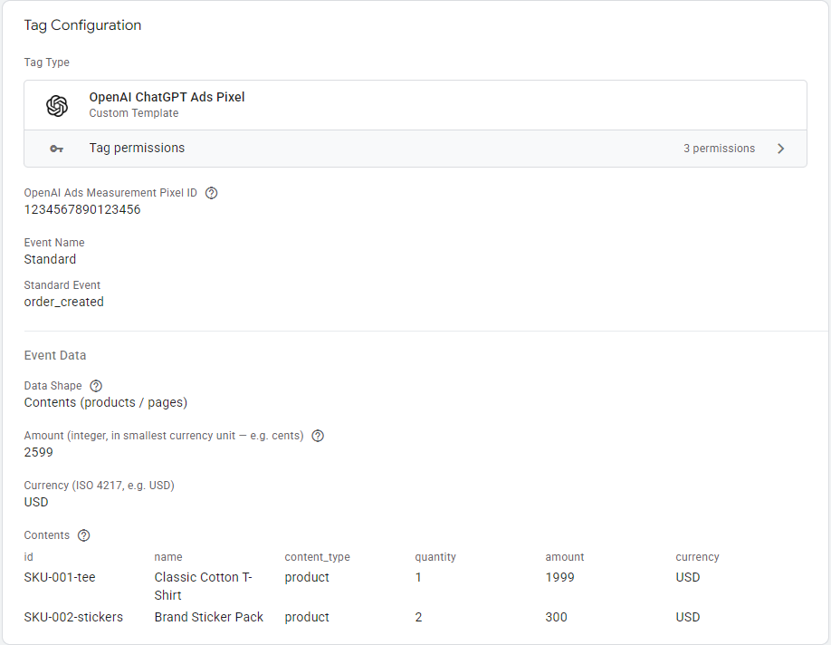
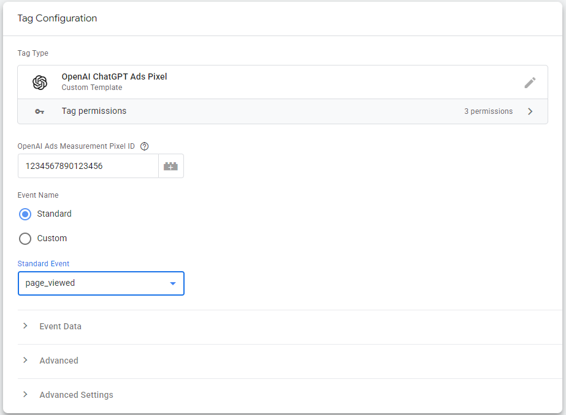
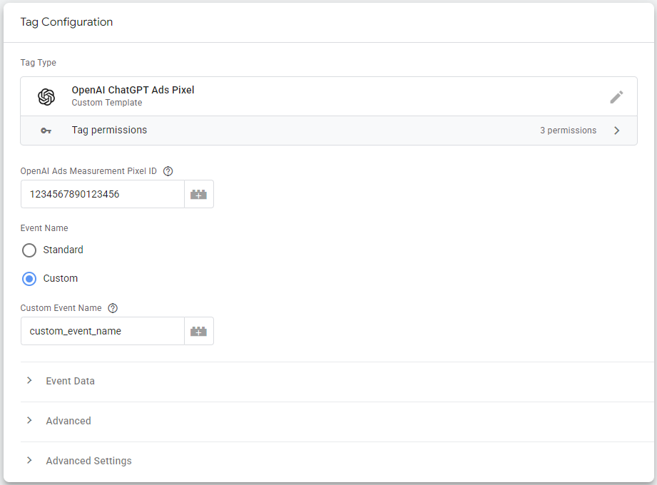

# OpenAI ChatGPT Ads Pixel — Google Tag Manager Web Custom Tag Template

A Google Tag Manager custom tag template for the [OpenAI ChatGPT Ads measurement pixel](https://developers.openai.com/ads/measurement-pixel). Handles SDK loading, pixel initialization and consent automatically, and fires standard or custom events with built-in deduplication support.

My goal was to make this tag template as simple as possible to use. The same template handles everything from the initial pixel fire to individual conversion events.

<p align="center">
  
</p>
<p align="center"><em>The tag configuration UI in Google Tag Manager, showing an order_created event with a Contents data shape.</em></p>

## Features

- Loads the OpenAI measurement SDK (`oaiq.min.js`) automatically, only once per page
- Initializes the pixel on every tag fire (no separate init/page view tag required)
- All documented standard events available from a dropdown, with the matching data shape set automatically
- Custom events, with name validation
- Sends each event only to the tag's own Pixel ID (`measureSingle`), so pages with more than one Pixel ID don't double count
- Measurement consent: fixed, from a variable, or following Google Consent Mode
- Optional user data for conversion matching, normalized and SHA-256 hashed in the browser
- Event ID field for browser/server-side conversion deduplication
- Opt-out flag and debug mode

## Installation

### From the Community Gallery

Once approved, search for **OpenAI ChatGPT Ads Pixel** in the GTM template gallery and click **Add to workspace**.

### Manual install

1. Download [`template.tpl`](template.tpl) from this repo.
2. In GTM, go to **Templates → Tag Templates → New**.
3. Click the three-dot menu in the top right and choose **Import**.
4. Select `template.tpl`, then **Save**.

You can now create tags using **Custom → OpenAI ChatGPT Ads Pixel**.

## Configuration

### Required fields

| Field | Description |
|---|---|
| OpenAI Ads Measurement Pixel ID | Created in the Conversions tab of OpenAI Ads Manager. |
| Event Name | Choose **Standard** (with documented events) or **Custom**. |

### Standard events

- `page_viewed`
- `appointment_scheduled`
- `checkout_started`
- `contents_viewed`
- `items_added`
- `lead_created`
- `order_created`
- `registration_completed`
- `subscription_created`
- `trial_started`

`app_installed` and `app_opened` are Conversions API only, so they aren't in the list.

### Event data

Every event is sent with a `type` that matches its data shape. The template sets it for you:

| Shape | Events | Fields sent |
|---|---|---|
| `contents` | `page_viewed`, `contents_viewed`, `items_added`, `checkout_started`, `order_created` | Amount, currency, contents |
| `customer_action` | `lead_created`, `registration_completed`, `appointment_scheduled` | Amount, currency |
| `plan_enrollment` | `subscription_created`, `trial_started` | Amount, currency, plan ID, contents |
| `custom` | Any custom event | Amount, currency, plan ID, contents |

Fields an event's shape doesn't use are ignored, so you can leave them filled in.

- `amount` and `quantity` must be integers in the smallest currency unit. For example, `2599` represents $25.99 USD.
- An amount is only sent when a currency is set. If the currency is missing, the template drops the amount, still sends the event, and logs a warning in Preview mode.
- Each contents row takes `id`, `name`, `content_type` (any category, such as `product`, `plan` or `page`), `quantity`, `amount` and `currency`. A row amount needs a row or event currency.

### Custom event names

Names are converted to lowercase. They must be 1–64 letters, numbers, underscores or dashes, start and end with a letter or number, and not match a standard event name (including `custom`, `app_installed` and `app_opened`). If a name fails these rules at runtime, the tag fails instead of sending an event the Pixel would reject.

### User data

Optional. Sent in the `init` call to help OpenAI match conversions when there's no click ID.

| Field | Sent as | Normalization before hashing |
|---|---|---|
| Email | `email_sha256` | Trimmed, lowercase |
| Phone number | `phone_number_sha256` | Digits only, leading zeroes removed, 8–15 digits (keep the country code) |
| External ID | `external_id_sha256` | Trimmed, case kept |
| First name / Last name | `first_name_sha256` / `last_name_sha256` | Lowercase, whitespace and ASCII punctuation removed, accents kept |
| Country | `country` | Two-letter code, uppercase, not hashed |
| City, region, postal code | `city`, `region`, `postal_code` | Trimmed, not hashed |

If your variables already return SHA-256 hashes, tick **already SHA-256 hashed** and the values are passed through as lowercase hex. Raw identifiers never leave the browser unhashed.

OpenAI's Pixel also has automatic advanced matching, configured in Ads Manager. It needs nothing from this template.

### Consent

| Setting | What happens |
|---|---|
| Don't set | No consent call. The Pixel defaults to granted, unless it has a stored denial. |
| Follow Google Consent Mode | Reads `ad_storage`. Denied sends `oaiq("consent", false)` before `init`. When `ad_storage` is later granted, the template sends `oaiq("consent", true)` straight away. |
| Granted / Denied | Sends `oaiq("consent", true)` or `oaiq("consent", false)` before `init`. |
| A variable | Returns `true`/`false` or `granted`/`denied`. |

While consent is denied the Pixel sends no events and removes its `__oppref` and `__obref` cookies. Events blocked during that time are not replayed.

### Advanced fields

| Field | Description |
|---|---|
| Event ID | Optional. Used to deduplicate browser and server-side events. OpenAI deduplicates on Pixel ID + event name + Event ID. |
| Opt out of personalization | Sends `opt_out: true`. OpenAI says it doesn't currently use Pixel data for user-level personalization, but will respect this flag if that changes. |
| Debug mode | Logs SDK activity to the browser console. Useful while configuring; turn off in production. |

### More than one Pixel ID

Each tag sends its events with `oaiq("measureSingle", pixelId, ...)`, so an event only reaches the Pixel ID in that tag. If you have two accounts on one site, create a tag for each Pixel ID. OpenAI's plain `measure` command sends to every Pixel ID initialized on the page, which is why the template doesn't use it.

## Usage examples

### Page view on all pages

```
Pixel ID: 1234567890
Event Name: Standard → page_viewed
Trigger: All Pages
```

<p align="center">
  
</p>
<p align="center"><em>The tag configuration UI in Google Tag Manager, showing a page_viewed standard event.</em></p>


### Ecommerce purchase

```
Pixel ID: 1234567890
Event Name: Standard → order_created
Amount: {{DLV - ecommerce.value_in_cents}}
Currency: {{DLV - ecommerce.currency}}
Contents:
  id={{DLV - item_id}}, name={{DLV - item_name}}, content_type=product,
  quantity={{DLV - item_quantity}}, amount={{DLV - item_price_in_cents}},
  currency={{DLV - ecommerce.currency}}
Event ID: {{DLV - transaction_id}}
Trigger: Custom Event "purchase"
```

### Lead form submission

```
Pixel ID: 1234567890
Event Name: Standard → lead_created
User Data → Email: {{DLV - form_email}}
Trigger: Form Submission on /contact/
```

### Subscription signup

```
Pixel ID: 1234567890
Event Name: Standard → subscription_created
Plan ID: pro_monthly
Amount: 1499
Currency: USD
Event ID: {{DLV - subscription_id}}
```

### Custom event

```
Pixel ID: 1234567890
Event Name: Custom
Custom Event Name: quote_requested
Event ID: quote_{{DLV - quote_id}}
```

<p align="center">
  
</p>
<p align="center"><em>The tag configuration UI in Google Tag Manager, showing custom_event_name custom event.</em></p>


## Server-side deduplication

If you also send conversions through OpenAI's [Conversions API](https://developers.openai.com/ads/conversions-api), use the same value for the pixel **Event ID** and the API event `id`, and send both with the same Pixel ID. OpenAI deduplicates on:

```
Pixel ID + event name + event_id
```

For custom events, the deduplication key uses `custom_event_name` instead of the event name, so reuse the same `custom_event_name` on both sides. The Conversions API lowercases custom event names, and so does this template. OpenAI keeps the first event it receives and ignores later duplicates.

## Permissions

The template requests four permissions:

| Permission | Why |
|---|---|
| **Inject script** (`https://bzrcdn.openai.com/sdk/oaiq.min.js`) | Loads OpenAI's hosted measurement SDK. The pixel cannot send data without this. |
| **Access globals** (`oaiq`, `oaiq.q`) | `oaiq` is the SDK's command queue function (created by the template, later replaced by the SDK itself). `oaiq.q` is the array used to buffer calls until the SDK finishes loading. Both are part of the documented OpenAI installation pattern. |
| **Access consent state** (`ad_storage`, read only) | Used only when Consent is set to follow Google Consent Mode. |
| **Log to console** (debug environment only) | Logs SDK load failures and skipped or invalid fields in Preview mode. |

## Privacy and data

This template loads OpenAI's hosted SDK from `bzrcdn.openai.com`. The SDK transmits conversion data to OpenAI according to their published privacy policy.

Use the **Consent** setting to pass measurement consent to the Pixel. You can also use GTM's built-in [consent settings](https://support.google.com/tagmanager/answer/10718549) or trigger conditions to stop the tag from firing at all.

User data fields are hashed with SHA-256 in the browser before they are sent. Only fill them in where your privacy policy and consent flow allow it.

### Content Security Policy

If your site sets a CSP, add these sources:

| Directive | Source |
|---|---|
| `script-src` | `https://bzrcdn.openai.com` |
| `connect-src` | `https://bzr.openai.com`, `https://bzrcdn.openai.com` |
| `img-src` | `https://bzr.openai.com` |

## Compatibility

- Google Tag Manager Web container
- OpenAI ChatGPT Ads measurement pixel (`oaiq.min.js`)
- Documented against the OpenAI pixel reference as of the version listed in [`template.tpl`](template.tpl)

## Development

### Running the tests

The template ships with 15 test scenarios covering all major code paths. To run them:

1. In GTM, open **Templates → Tag Templates → OpenAI ChatGPT Ads Pixel**.
2. Click the **Tests** tab.
3. Click **Run tests**.

All 15 scenarios should pass. The tests cover:

- Standard `page_viewed` event (init + `measureSingle`, `contents` type set)
- `order_created` with a full contents payload (integer coercion, currency uppercased)
- Custom event (`custom` type, lowercased `custom_event_name`, `plan_id` and contents)
- Invalid custom event names rejected
- `plan_enrollment` with `plan_id` and contents
- `customer_action` ignores plan ID and contents
- Amounts without a currency dropped, and `quantity: 0` kept
- Debug and opt-out flags
- SDK only injected once across multiple tag fires
- Two Pixel IDs on one page each get only their own events
- Empty contents array omitted from payload
- Consent sent before `init`
- Google Consent Mode, including the grant listener
- User data normalized and hashed in `init`
- Pre-hashed user data passed through, invalid phone numbers skipped

### Reporting issues

Issues, suggestions and pull requests are welcome on the [issue tracker](https://github.com/ditomaso/openai-chatgpt-ads-pixel-tag/issues).

## License

Apache 2.0. See [LICENSE](LICENSE).

## Credits

Built by [Dana DiTomaso](https://www.linkedin.com/in/danaditomaso/) at [Kick Point](https://kickpoint.ca).

## Resources

- [OpenAI Ads Measurement Pixel documentation](https://developers.openai.com/ads/measurement-pixel)
- [OpenAI Ads Supported Events documentation](https://developers.openai.com/ads/supported-events)
- [OpenAI Ads Multiple Pixel IDs documentation](https://developers.openai.com/ads/multiple-pixels)
- [OpenAI Ads Conversions API documentation](https://developers.openai.com/ads/conversions-api)
- [GTM Community Template Gallery](https://tagmanager.google.com/gallery/)
- [GTM Custom Templates documentation](https://developers.google.com/tag-platform/tag-manager/templates)
